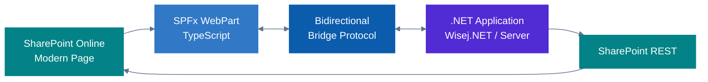
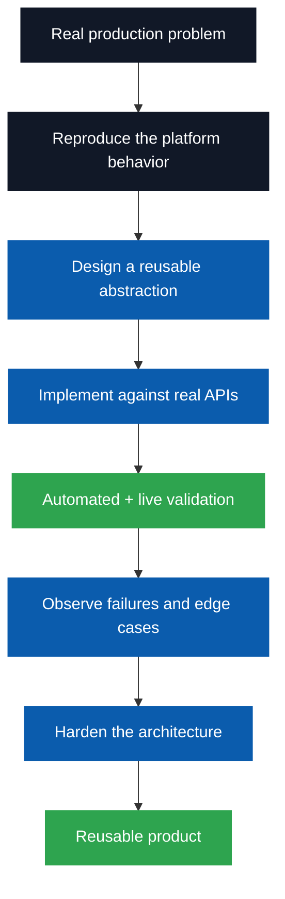

<div align="center">

# Gabriele Del Giovine
## SharePoint & .NET Engineering Portfolio

### I design and build real software products — not just demos or isolated customizations.

<br/>


<br/>


</div>

---

## What this portfolio demonstrates

I work primarily on **enterprise .NET and Microsoft SharePoint engineering**, with an emphasis on solving integration problems that usually require substantial custom development.

The projects below are not tutorial exercises. They are engineering products designed around real operational constraints such as:

- SharePoint Online and SharePoint Server interoperability
- legacy and modern .NET coexistence
- REST, OData, CAML and SPFx integration
- migration, reusable template packaging and repeatable provisioning
- relational data abstractions
- authentication and identity
- asynchronous and concurrent processing
- compatibility, regression testing and live validation
- Windows services, native integration and enterprise deployment

My objective is simple:

> **Build systems that work in real environments, understand why they work, and make difficult integration problems reusable.**

---

# Four SharePoint engineering products

These products address complementary problems in the SharePoint and Microsoft 365 ecosystem. The first three focus on data access, migration and integration; the fourth focuses on reusable templates and provisioning.

~~~mermaid
flowchart LR
    DATA["DATA ACCESS<br/>GDG.SP.ADOProvider<br/>SQL · ADO.NET · REST"]
    MIG["MIGRATION<br/>GDG SPMigrator<br/>On-premises → Online"]
    BRIDGE["INTEGRATION<br/>GDG.SPFX.Bridge<br/>SPFx ↔ .NET"]
    TM["TEMPLATES<br/>GDG.SP.TemplateManager<br/>Capture · Inspect · Provision"]

    DATA --- MIG
    MIG --- BRIDGE
    BRIDGE --- TM

    classDef data fill:#512BD4,color:#fff,stroke:#512BD4;
    classDef mig fill:#0B5CAD,color:#fff,stroke:#0B5CAD;
    classDef bridge fill:#038387,color:#fff,stroke:#038387;
    classDef tm fill:#6A5099,color:#fff,stroke:#6A5099;
    class DATA data;
    class MIG mig;
    class BRIDGE bridge;
    class TM tm;
~~~

| Product | Engineering problem | What it demonstrates |
|---|---|---|
| **GDG.SP.ADOProvider** | Access SharePoint lists, files and attachments through familiar .NET data APIs | ADO.NET provider, SQL parser/optimizer, CAML/OData/REST, relational operators, Dapper and real WinForms applications |
| **GDG SPMigrator** | Move SharePoint structures, permissions and content | migration orchestration, provisioning, ACL/identity mapping and recovery |
| **GDG.SPFX.Bridge** | Connect modern SharePoint experiences to server-side .NET | SPFx, browser/server messaging, host context, CRUD integration and lifecycle coordination |
| **GDG.SP.TemplateManager** | Capture and reuse SharePoint configurations and selected content | portable `.gdgspt` packages, inspection, compatibility analysis, target provisioning, gallery integration and LIVE-oriented validation |

---

## Official website & public demonstrations

The [GDG Engineering official website](https://www.gabrieledelgiovine.it/) presents the SharePoint product family. The product-specific links below lead to the dedicated pages supplied by the author; accompanying LinkedIn links lead to public demonstrations and technical posts.

| Product | Official website | Public demo / LinkedIn post |
|---|---|---|
| **GDG.SP.ADOProvider** | [Official product page](https://www.gabrieledelgiovine.it/products/ADOProvider/) | [ADOProvider in action — video demo](https://www.linkedin.com/posts/gabriele-del-giovine-976626_gdgspadoprovider-in-azione-demo-livello-ugcPost-7519042942741905409-Ib1n) · [Technical product post](https://www.linkedin.com/posts/gabriele-del-giovine-976626_httpslnkdindreeup6a-treat-sharepoint-activity-7500930892006219776-1Kx8) |
| **GDG SPMigrator / GDG.SP.Migration** | [Official product page](https://www.gabrieledelgiovine.it/products/SPMigration) | [Migration facts and outcomes — LinkedIn post](https://it.linkedin.com/posts/gabriele-del-giovine-976626_gdg-spmigration-per-sharepoint-fatti-activity-7508832210918080514-rfpq) |
| **GDG.SPFX.Bridge / GDGSPFxBridge** | [Official product page](https://www.gabrieledelgiovine.it/products/GDGSPFxBridge) | [SPFx ↔ Wisej.NET — video demo](https://www.linkedin.com/posts/gabriele-del-giovine-976626_what-youre-seeing-in-the-video-is-sharepoint-activity-7497553165131898881-JQap) |
| **GDG.SP.TemplateManager** | [Official product page](https://www.gabrieledelgiovine.it/products/SPTemplateManager) | Video link not yet publicly verified |

**Other public demonstration:** [Passero Framework — Episode 1, low-code approach (LinkedIn video post)](https://it.linkedin.com/posts/gabriele-del-giovine-976626_passero-framework-ep1-la-modalit%C3%A0-low-activity-7400860628934070272-fPsy).

[LinkedIn profile and posts](https://it.linkedin.com/in/gabriele-del-giovine-976626) · [Corporate contact page](https://www.gabrieledelgiovine.it/front_page/contact/)

---

# 1. GDG.SP.ADOProvider

<div align="center">

### ADO.NET Data Provider and Relational Engine for Microsoft SharePoint


[**Official website →**](https://www.gabrieledelgiovine.it/products/ADOProvider/) · [**Public product showcase →**](https://github.com/gdelgiovine/GDG.SP.ADOProvider-Showcase) · [**Video demo on LinkedIn →**](https://www.linkedin.com/posts/gabriele-del-giovine-976626_gdgspadoprovider-in-azione-demo-livello-ugcPost-7519042942741905409-Ib1n) · [**Technical LinkedIn post →**](https://www.linkedin.com/posts/gabriele-del-giovine-976626_httpslnkdindreeup6a-treat-sharepoint-activity-7500930892006219776-1Kx8)

</div>

`GDG.SP.ADOProvider` exposes SharePoint lists, document libraries and list attachments through a standard **ADO.NET programming model** and a SQL-like language. It has a **REST-only runtime**, with no CSOM dependency, and targets `net48` and `net8.0`, against **SharePoint Online** and **SharePoint Server Subscription Edition**.

### Developer-facing API

~~~text
DbProviderFactory
DbConnection
DbCommand
DbParameter
DbDataReader
DbDataAdapter
DbCommandBuilder
~~~

Rather than writing HTTP/OData/CAML plumbing in each application, client code uses familiar data-access abstractions.

~~~sql
SELECT O.ID, O.Title, C.Title AS CustomerName
FROM Orders O
INNER JOIN Customers C ON O.CustomerId = C.ID
WHERE O.Status = @Status
ORDER BY O.ID;
~~~

### Engineering behind the product

- SQL tokenizer, parser, AST, binding and relational execution.
- `JOIN`, correlated and set-operation patterns, aggregation/`GROUP BY`/`HAVING`, `DISTINCT`, `UNION` and `UNION ALL`.
- SQL-like `INSERT`, `UPDATE` and `DELETE`, supported DDL/DCL and parameterized commands.
- Query planner with **semantic eligibility before cost**; cost-based optimization, plan caching and safe local execution fallback.
- CAML via SharePoint REST, selective OData `$select`/`$expand`/`$filter`, `$batch` and supported server-side aggregation paths.
- Identity-aware metadata caching, SharePoint change-log invalidation, digest caching and concurrency controls.
- Document-library content operations, folder-scoped selection and the `$ATTACHMENTS(...)` model for SharePoint list files.
- Explicit scan/mutation limits designed to avoid silently incomplete relational results.

### From a provider API to working line-of-business demonstrations

Three independent **Windows Forms MiniERP variants** now demonstrate the same three-list scenario: **Agents, Customers, Orders**, with lookup relationships and item attachments.

| Demonstration | Main data-access pattern | Engineering proof |
|---|---|---|
| **MiniERP** | ADO.NET, `DataTable`, UI binding and explicit parameterized commands | Multi-list CRUD, lookup integrity, attachment upload/download/replace/rename/delete and responsive task-based UI |
| **MiniERP Classic** | Straightforward C#, `SharePointDataAdapter.Fill(DataTable)` and explicit commands | A deliberately readable migration path for traditional WinForms and VB.NET developers |
| **MiniERP Dapper** | Dapper + typed C# POCOs and `BindingList<T>` | Reuse of the provider with a mainstream micro-ORM, without direct SharePoint API calls in application code |

The desktop examples reuse a connection-management component supporting **WebView2 interactive sign-in, MFA and remembered sessions**, plus the provider's supported SharePoint Server authentication options. The sample applications are demonstrations, not claims of full ERP or transactional-database semantics.

### Validation and release discipline

The source currently documents **`1.0.2-rc.1` as a release candidate**, **not** as a published stable release or public NuGet package. It includes Windows demo applications, offline conformance suites, SharePoint Online/Server SE LIVE test paths, and formal packaging/validation gates for both target frameworks. Recent work also addresses plan-cache concurrency.

> **Engineering principle:** the provider must preserve query semantics and make SharePoint's actual limits explicit; it does not pretend that SharePoint is SQL Server.

### What this project demonstrates


---

# 2. GDG SPMigrator

<div align="center">

### SharePoint Migration Engineering


</div>

[**Official website →**](https://www.gabrieledelgiovine.it/products/SPMigration) · [**LinkedIn migration results →**](https://it.linkedin.com/posts/gabriele-del-giovine-976626_gdg-spmigration-per-sharepoint-fatti-activity-7508832210918080514-rfpq)

`GDG SPMigrator` addresses the practical complexity of moving SharePoint workloads from on-premises environments to Microsoft 365.

The product is built around a migration pipeline rather than a simple copy command.

### Migration concerns handled by the architecture

```text
Source discovery
      ↓
Schema analysis
      ↓
Target provisioning
      ↓
Content migration
      ↓
Identity / ACL mapping
      ↓
Validation / progress / diagnostics
```

Engineering areas include:

- SharePoint On-Premises → SharePoint Online migration
- target site provisioning
- source/target language alignment
- list and document-library migration
- schema and content-type normalization
- content migration jobs
- identity resolution
- ACL preservation and reconstruction
- guest/member identity scenarios
- navigation migration
- taxonomy-related provisioning
- task persistence
- progress tracking
- cancellation/stop handling
- migration logs and diagnostics

### Why this project matters as engineering evidence

Migration code has to deal with APIs that are not always symmetric.

Exported structures are not automatically guaranteed to be import-compatible. Real migrations expose edge cases around manifests, schema validation, identities, permissions and platform-specific behavior.

The project therefore demonstrates more than SharePoint API knowledge:

> **it demonstrates the ability to investigate undocumented behavior, redesign around platform constraints and keep the migration process observable and recoverable.**

### What this project demonstrates


> Public showcase material for GDG SPMigrator can be added here when available.

---

# 3. GDG.SPFX.Bridge

<div align="center">

### Bidirectional SPFx ↔ .NET Integration


</div>

[**Official website →**](https://www.gabrieledelgiovine.it/products/GDGSPFxBridge) · [**Watch the SPFx/Wisej.NET video demonstration →**](https://www.linkedin.com/posts/gabriele-del-giovine-976626_what-youre-seeing-in-the-video-is-sharepoint-activity-7497553165131898881-JQap)

`GDG.SPFX.Bridge` connects SharePoint Framework experiences with server-side .NET applications through a controlled bidirectional integration channel.

It was designed to solve a common architectural problem:

```text
Modern SharePoint
      |
     SPFx
      |
 Browser boundary
      |
 .NET application
```

without forcing the .NET application to become an SPFx application itself.

### Capabilities

The bridge handles:

- SharePoint host context
- appearance/bootstrap information
- SPFx Dynamic Data
- selected items and list context
- navigation information
- host-to-.NET routing
- configurable list actions
- SharePoint REST operations
- CRUD scenarios
- item-level native list refresh
- new/edit/delete integration
- multiple application-instance routing

### Architecture



### Engineering challenge

A bridge like this has to respect both sides of the boundary:

- SharePoint Modern UI lifecycle
- SPFx client-side execution
- browser messaging and routing
- server-side application lifecycle
- native list actions
- refresh behavior without unnecessary full-page reloads

The project includes extensive investigation of SharePoint list refresh mechanisms so that CRUD operations can update list state without treating a full browser reload as the default solution.

### What this project demonstrates


> Public showcase material for GDG.SPFX.Bridge can be added here when available.

---

# 4. GDG.SP.TemplateManager

<div align="center">

### Reusable SharePoint Templates, Inspection and Provisioning


</div>

[**Official website — SharePoint templates overview →**](https://www.gabrieledelgiovine.it/products/SPTemplateManager)

`GDG.SP.TemplateManager` is a Windows Forms application for **capturing, storing, inspecting and reapplying SharePoint Online structures and selected content**. Its reusable **`.gdgspt` package** is separate from the source site and can be provisioned again later.

Unlike a one-off migration tool, TemplateManager focuses on **repeatable provisioning from reusable artifacts**.

### End-to-end workflow

~~~text
SharePoint Online SOURCE
          |
   Capture / Select
          v
   Portable .gdgspt
          |
  Template Library
   /     |       \
Inspect  Analyze   Provision
                  |
                  v
         SharePoint Online TARGET
~~~

Direct SOURCE-to-TARGET provisioning also exists; it uses the shared extraction/package/provisioning pipeline rather than a second independent engine.

### Engineering scope

- **Capture** site/subsite structures, lists and document libraries; optionally include list items, folders, files and attachments with granular selection.
- **Package format** preserving metadata and dependencies, designed for reuse without requiring the original SOURCE during subsequent provisioning.
- **Template Library** for managed packages, import/export and operational provisioning.
- **Template Inspector**, covering manifest, hierarchy, fields, content types, views, content, navigation, features, security and dependencies.
- **BOM/SBOM and compatibility analysis**, including SOURCE-only analysis and TARGET preflight before applying a package.
- **Provisioning** with Lookup-reference remapping, field/content-type reconstruction, optional content and security handling; support for new sites and selected site templates.
- **Runtime TARGET parameterization:** override a new site/subsite's title/URL, or a new list/library's title/URL, without rewriting original package metadata.
- **SharePoint native Gallery support** for the portable subset of site/list/library designs, while complex content and permissions remain in GDG extended provisioning.
- **Observability:** operation phases, progress, activity logs, pause/stop controls and an integrated test runner.

### Opt-in CSOM read optimizations

The 0.6.7 source candidate adds independent, explicitly enabled optimizations for extraction and provisioning metadata reads. A benchmark-oriented test suite compares standard **OFF** and optimized **ON** paths and checks fidelity, rather than assuming fewer round trips automatically imply equivalent results.

### Platform and validation status

- **Runtime:** Windows Forms, `.NET Framework 4.8`; development with Visual Studio 2026.
- **Source/TARGET:** SharePoint Online. The solution uses **CSOM** for relevant extraction and provisioning operations, distinct from ADOProvider's REST-only architecture.
- **Status:** the repository documents a **0.6.7 candidate** and integrated MSTest/WinForms TestRunner work; the newer optimization/benchmark changes should not be presented as production-certified without their full Windows and LIVE acceptance evidence.

### Why it matters

> **SPMigrator moves workloads; TemplateManager turns selected SharePoint configurations into inspectable, portable assets that can be provisioned repeatedly.**

This project demonstrates reusable packaging, dependency modeling, compatibility analysis, real SharePoint provisioning, conservative Gallery translation, GUI engineering and testable operational workflows.

**Source availability:** currently private. Technical demonstrations or evaluations can be discussed directly.

---

# The common engineering pattern

Although the four SharePoint products solve different problems, the same engineering approach appears repeatedly.



I prefer:

- reproducible behavior over assumptions
- explicit architecture over ad-hoc API calls
- semantic correctness over premature optimization
- diagnostics over opaque failure
- backward compatibility over unnecessary breakage
- real environment validation over demo-only success

---

# Engineering evidence

The portfolio is intended to show not only technologies, but the level at which they are used.

### Architecture

```text
ADO.NET provider architecture
relational query engines
query planners and optimizers
migration pipelines
reusable SharePoint template packages and provisioning
browser/server integration protocols
Windows service architectures
multi-process communication
```

### Microsoft / SharePoint

```text
SharePoint Online
SharePoint Server Subscription Edition
SharePoint Server 2019
SharePoint REST
CAML
OData
CSOM (TemplateManager; ADOProvider remains REST-only)
SPFx
Microsoft 365
authentication / identities / permissions
lists / libraries / metadata / navigation
```

### .NET

```text
C#
.NET Framework 4.8
.NET 8+
ASP.NET Core
WinForms
Wisej.NET
ADO.NET
Dapper
Entity Framework
async / cancellation
multi-target libraries
```

### Product engineering

```text
architecture documentation
regression suites
live integration tests
integrated test runners and reproducible benchmarks
compatibility matrices
configuration tooling
diagnostics and logging
release baselines
incremental hardening
```

---

# Beyond SharePoint

The same product-engineering approach is used in other projects.

## GDG.PortMonitor

[](https://github.com/gdelgiovine/GDG.PortMonitor)

A Windows print-port and document-conversion orchestration system that combines:

- a native Windows Port Monitor
- Windows Print Spooler integration
- Named Pipes
- managed Windows services
- PDL detection
- configurable external converters
- Windows Job Objects
- timeout/process-tree management
- realtime monitoring
- enterprise logging and metadata

This project demonstrates low-level Windows integration and managed/native architecture outside the SharePoint domain.

---

## Passero Framework

[](https://github.com/gdelgiovine/PasseroFramework)

[**LinkedIn post with video — Passero Framework Ep. 1 →**](https://it.linkedin.com/posts/gabriele-del-giovine-976626_passero-framework-ep1-la-modalit%C3%A0-low-activity-7400860628934070272-fPsy)

An MVVM-oriented framework for enterprise applications, with areas including:

- generic ViewModels
- repository patterns
- Dapper-based data access
- data binding
- change tracking
- query-by-example
- reusable UI controls
- reporting integration
- enterprise application infrastructure

This demonstrates framework design and reusable application architecture rather than project-specific coding.

---

## RazorBlazorDataExchange

[](https://github.com/gdelgiovine/RazorBlazorDataExchange)

An integration project focused on bidirectional communication between Razor/MVC and .NET Blazor application components.

It reflects the same recurring interest in solving boundaries between application models rather than treating each technology as an isolated silo.

---

# What I am looking for

I am interested in **long-term technical collaborations** where deep .NET and Microsoft platform engineering is more valuable than short-term staff augmentation.

Relevant scenarios include:

- software companies building Microsoft 365 / SharePoint products
- Microsoft partners and system integrators
- ISVs integrating SharePoint into existing .NET products
- enterprise teams modernizing .NET Framework systems
- organizations with complex SharePoint Online / Server coexistence
- migration-product and SharePoint provisioning teams
- product engineering groups that need senior architecture and implementation capability

Possible collaboration models include:

```text
Senior Software Engineer
Software Architect
Technical Lead
Product Engineer
Long-term independent consultant
Technical partner for a software product
```

---

# What I bring to a team

I do not define seniority only by the number of technologies used.

The differentiator I want this portfolio to show is the ability to move through the entire engineering cycle:

```text
Understand the real problem
          ↓
Reproduce it
          ↓
Design the abstraction
          ↓
Implement it
          ↓
Test it against real systems
          ↓
Find where assumptions fail
          ↓
Redesign when necessary
          ↓
Deliver a reusable system
```

That is the kind of work I am interested in continuing to do.

---

# About me

**Gabriele Del Giovine**  
Independent Software Consultant & Developer  
Italy

Former **Microsoft MVP (2002–2010)**.

My work focuses primarily on:

- C# and .NET
- Microsoft SharePoint / Microsoft 365
- enterprise application architecture
- data-access technologies
- migration and interoperability
- modernization of existing business applications
- reusable frameworks and infrastructure components

---

# Contact / technical discussion

<div align="center">

### Looking for senior .NET / SharePoint engineering capability?

[**Official website**](https://www.gabrieledelgiovine.it/) · [**LinkedIn profile**](https://it.linkedin.com/in/gabriele-del-giovine-976626) · [**Contact**](https://www.gabrieledelgiovine.it/front_page/contact/)

[](https://github.com/gdelgiovine)

### Interested in a product demonstration or technical evaluation?

[](https://github.com/gdelgiovine/GDG.SP.ADOProvider-Showcase)

<br/>

**I am open to long-term collaborations, technical evaluations and product partnerships with software companies, Microsoft partners, ISVs and enterprise engineering teams.**

</div>

---

<sub>
Microsoft, .NET, Microsoft 365 and SharePoint are trademarks of the Microsoft group of companies.  
The projects presented here are independent works and are not affiliated with, sponsored by, or endorsed by Microsoft.
</sub>
