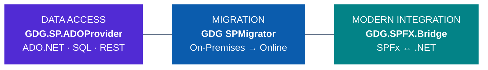
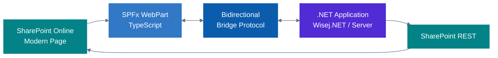
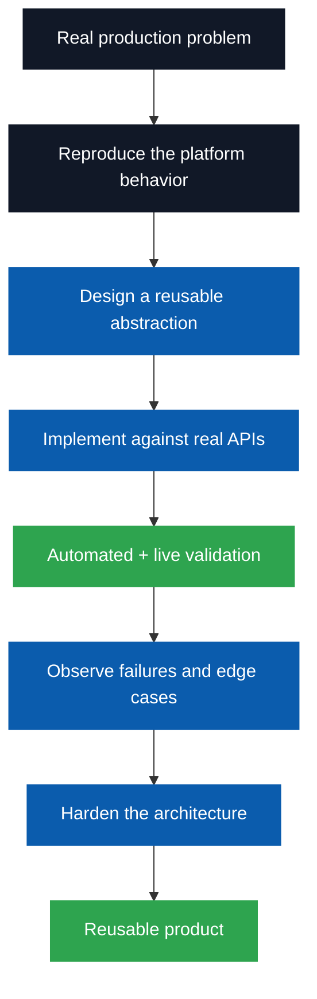

<div align="center">

# Gabriele Del Giovine
## SharePoint & .NET Engineering Portfolio

### I design and build real software products — not just demos or isolated customizations.

<br/>


<br/>


</div>

---

## What this portfolio demonstrates

I work primarily on **enterprise .NET and Microsoft SharePoint engineering**, with an emphasis on solving integration problems that usually require substantial custom development.

The projects below are not tutorial exercises. They are engineering products designed around real operational constraints such as:

- SharePoint Online and SharePoint Server interoperability
- legacy and modern .NET coexistence
- REST, OData, CAML and SPFx integration
- migration and provisioning
- relational data abstractions
- authentication and identity
- asynchronous and concurrent processing
- compatibility, regression testing and live validation
- Windows services, native integration and enterprise deployment

My objective is simple:

> **Build systems that work in real environments, understand why they work, and make difficult integration problems reusable.**

---

# Three SharePoint engineering products



These three products address three different SharePoint engineering problems:

| Product | Problem solved | Engineering evidence |
|---|---|---|
| **GDG.SP.ADOProvider** | Treat SharePoint as an application data source through a familiar ADO.NET programming model | data-provider architecture, SQL parsing, relational execution, query planning, REST/CAML/OData, caching, batching, async, compatibility |
| **GDG SPMigrator** | Move SharePoint structures and content from on-premises environments to SharePoint Online | migration architecture, provisioning, identity/ACL handling, schema compatibility, task orchestration, diagnostics, recovery |
| **GDG.SPFX.Bridge** | Connect modern SharePoint Framework experiences with server-side .NET applications | SPFx, TypeScript, browser/server messaging, SharePoint context, Dynamic Data, CRUD, routing, native list refresh |

---

# 1. GDG.SP.ADOProvider

<div align="center">

### SQL & ADO.NET Provider for Microsoft SharePoint


[**Open the public product showcase →**](https://github.com/gdelgiovine/GDG.SP.ADOProvider-Showcase)

</div>

`GDG.SP.ADOProvider` exposes SharePoint lists and document libraries through standard ADO.NET abstractions and SQL-like queries.

Application code can use:

```text
DbProviderFactory
DbConnection
DbCommand
DbParameter
DbDataReader
DbDataAdapter
DbCommandBuilder
```

instead of embedding SharePoint-specific REST plumbing throughout the application.

### Example

```sql
SELECT O.ID,
       O.Title,
       C.Title AS CustomerName
FROM Orders O
INNER JOIN Customers C
    ON O.CustomerId = C.ID
WHERE O.Status = @Status
ORDER BY O.ID;
```

### Engineering behind the product

The project includes:

- SQL tokenizer/parser and AST
- relational query engine
- JOIN processing
- aggregation engine
- `DISTINCT`
- `UNION` / `UNION ALL`
- expression evaluation
- DML including `INSERT ... SELECT`
- metadata/schema handling
- document libraries
- SharePoint list attachments
- REST/CAML/OData translation
- `$batch`
- server-side and local execution strategies
- cost-based planning
- semantic eligibility checks
- metadata and request-digest caching
- async ADO.NET APIs and cancellation
- multi-target `net48;net8.0`

### Architecture principle

> **Semantic eligibility before cost.**

The optimizer may compare execution strategies only after determining that they preserve the requested result.

That means the provider can push work to SharePoint when safe and use local relational execution when SharePoint cannot represent the requested operation correctly.

### Validation

The provider is not parser-only or mock infrastructure.

It has been validated with dedicated test suites against:

```text
.NET Framework 4.8
.NET 8.0

        ×

SharePoint Online
SharePoint Server Subscription Edition
```

### What this project demonstrates


---

# 2. GDG SPMigrator

<div align="center">

### SharePoint Migration Engineering


</div>

`GDG SPMigrator` addresses the practical complexity of moving SharePoint workloads from on-premises environments to Microsoft 365.

The product is built around a migration pipeline rather than a simple copy command.

### Migration concerns handled by the architecture

```text
Source discovery
      ↓
Schema analysis
      ↓
Target provisioning
      ↓
Content migration
      ↓
Identity / ACL mapping
      ↓
Validation / progress / diagnostics
```

Engineering areas include:

- SharePoint On-Premises → SharePoint Online migration
- target site provisioning
- source/target language alignment
- list and document-library migration
- schema and content-type normalization
- content migration jobs
- identity resolution
- ACL preservation and reconstruction
- guest/member identity scenarios
- navigation migration
- taxonomy-related provisioning
- task persistence
- progress tracking
- cancellation/stop handling
- migration logs and diagnostics

### Why this project matters as engineering evidence

Migration code has to deal with APIs that are not always symmetric.

Exported structures are not automatically guaranteed to be import-compatible. Real migrations expose edge cases around manifests, schema validation, identities, permissions and platform-specific behavior.

The project therefore demonstrates more than SharePoint API knowledge:

> **it demonstrates the ability to investigate undocumented behavior, redesign around platform constraints and keep the migration process observable and recoverable.**

### What this project demonstrates


> Public showcase material for GDG SPMigrator can be added here when available.

---

# 3. GDG.SPFX.Bridge

<div align="center">

### Bidirectional SPFx ↔ .NET Integration


</div>

`GDG.SPFX.Bridge` connects SharePoint Framework experiences with server-side .NET applications through a controlled bidirectional integration channel.

It was designed to solve a common architectural problem:

```text
Modern SharePoint
      |
     SPFx
      |
 Browser boundary
      |
 .NET application
```

without forcing the .NET application to become an SPFx application itself.

### Capabilities

The bridge handles:

- SharePoint host context
- appearance/bootstrap information
- SPFx Dynamic Data
- selected items and list context
- navigation information
- host-to-.NET routing
- configurable list actions
- SharePoint REST operations
- CRUD scenarios
- item-level native list refresh
- new/edit/delete integration
- multiple application-instance routing

### Architecture



### Engineering challenge

A bridge like this has to respect both sides of the boundary:

- SharePoint Modern UI lifecycle
- SPFx client-side execution
- browser messaging and routing
- server-side application lifecycle
- native list actions
- refresh behavior without unnecessary full-page reloads

The project includes extensive investigation of SharePoint list refresh mechanisms so that CRUD operations can update list state without treating a full browser reload as the default solution.

### What this project demonstrates


> Public showcase material for GDG.SPFX.Bridge can be added here when available.

---

# The common engineering pattern

Although the three products solve different problems, the same engineering approach appears repeatedly.



I prefer:

- reproducible behavior over assumptions
- explicit architecture over ad-hoc API calls
- semantic correctness over premature optimization
- diagnostics over opaque failure
- backward compatibility over unnecessary breakage
- real environment validation over demo-only success

---

# Engineering evidence

The portfolio is intended to show not only technologies, but the level at which they are used.

### Architecture

```text
ADO.NET provider architecture
relational query engines
query planners and optimizers
migration pipelines
browser/server integration protocols
Windows service architectures
multi-process communication
```

### Microsoft / SharePoint

```text
SharePoint Online
SharePoint Server Subscription Edition
SharePoint Server 2019
SharePoint REST
CAML
OData
SPFx
Microsoft 365
authentication / identities / permissions
lists / libraries / metadata / navigation
```

### .NET

```text
C#
.NET Framework 4.8
.NET 8+
ASP.NET Core
WinForms
Wisej.NET
ADO.NET
Dapper
Entity Framework
async / cancellation
multi-target libraries
```

### Product engineering

```text
architecture documentation
regression suites
live integration tests
compatibility matrices
configuration tooling
diagnostics and logging
release baselines
incremental hardening
```

---

# Beyond SharePoint

The same product-engineering approach is used in other projects.

## GDG.PortMonitor

[](https://github.com/gdelgiovine/GDG.PortMonitor)

A Windows print-port and document-conversion orchestration system that combines:

- a native Windows Port Monitor
- Windows Print Spooler integration
- Named Pipes
- managed Windows services
- PDL detection
- configurable external converters
- Windows Job Objects
- timeout/process-tree management
- realtime monitoring
- enterprise logging and metadata

This project demonstrates low-level Windows integration and managed/native architecture outside the SharePoint domain.

---

## Passero Framework

[](https://github.com/gdelgiovine/PasseroFramework)

An MVVM-oriented framework for enterprise applications, with areas including:

- generic ViewModels
- repository patterns
- Dapper-based data access
- data binding
- change tracking
- query-by-example
- reusable UI controls
- reporting integration
- enterprise application infrastructure

This demonstrates framework design and reusable application architecture rather than project-specific coding.

---

## RazorBlazorDataExchange

[](https://github.com/gdelgiovine/RazorBlazorDataExchange)

An integration project focused on bidirectional communication between Razor/MVC and .NET Blazor application components.

It reflects the same recurring interest in solving boundaries between application models rather than treating each technology as an isolated silo.

---

# What I am looking for

I am interested in **long-term technical collaborations** where deep .NET and Microsoft platform engineering is more valuable than short-term staff augmentation.

Relevant scenarios include:

- software companies building Microsoft 365 / SharePoint products
- Microsoft partners and system integrators
- ISVs integrating SharePoint into existing .NET products
- enterprise teams modernizing .NET Framework systems
- organizations with complex SharePoint Online / Server coexistence
- migration-product teams
- product engineering groups that need senior architecture and implementation capability

Possible collaboration models include:

```text
Senior Software Engineer
Software Architect
Technical Lead
Product Engineer
Long-term independent consultant
Technical partner for a software product
```

---

# What I bring to a team

I do not define seniority only by the number of technologies used.

The differentiator I want this portfolio to show is the ability to move through the entire engineering cycle:

```text
Understand the real problem
          ↓
Reproduce it
          ↓
Design the abstraction
          ↓
Implement it
          ↓
Test it against real systems
          ↓
Find where assumptions fail
          ↓
Redesign when necessary
          ↓
Deliver a reusable system
```

That is the kind of work I am interested in continuing to do.

---

# About me

**Gabriele Del Giovine**  
Independent Software Consultant & Developer  
Italy

Former **Microsoft MVP (2002–2010)**.

My work focuses primarily on:

- C# and .NET
- Microsoft SharePoint / Microsoft 365
- enterprise application architecture
- data-access technologies
- migration and interoperability
- modernization of existing business applications
- reusable frameworks and infrastructure components

---

# Contact / technical discussion

<div align="center">

### Looking for senior .NET / SharePoint engineering capability?

[](https://github.com/gdelgiovine)

### Interested specifically in GDG.SP.ADOProvider?

[](https://github.com/gdelgiovine/GDG.SP.ADOProvider-Showcase)

<br/>

**I am open to long-term collaborations with software companies, Microsoft partners, ISVs and enterprise engineering teams.**

</div>

---

<sub>
Microsoft, .NET, Microsoft 365 and SharePoint are trademarks of the Microsoft group of companies.  
The projects presented here are independent works and are not affiliated with, sponsored by, or endorsed by Microsoft.
</sub>
